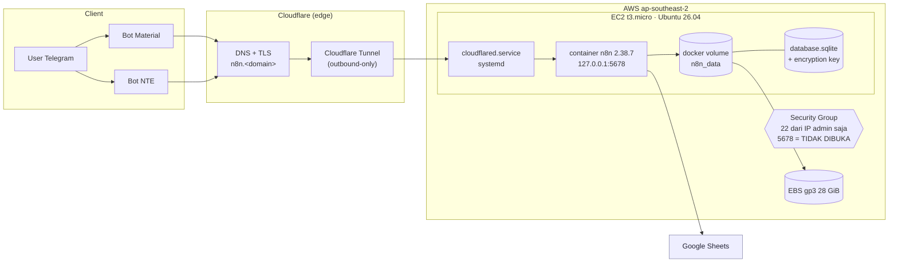

# n8n + Telegram Bot → AWS (EC2 · Docker · Cloudflare Tunnel)

> Studi kasus migrasi **workflow automation self-hosted** dari laptop pribadi (Windows) ke
> **AWS EC2 ap-southeast-2 (Sydney)** — tanpa downtime data, tanpa IP publik di port aplikasi,
> dengan domain HTTPS sendiri.

**Fokus: Cloud Engineering.** Repo ini bukan tutorial "klik-klik console" — isinya adalah
*decision record*, *runbook*, *script idempoten*, dan *bukti verifikasi* dari migrasi yang
benar-benar dijalankan.


-blue)


---

## 1. Ringkasan hasil

| Item | Sebelum (local) | Sesudah (AWS) |
|---|---|---|
| Host | Laptop Windows, `n8n start` manual | EC2 `t3.micro`, Ubuntu 26.04 LTS |
| Runtime | Node.js di host (berubah-ubah versi) | Docker `docker.n8n.io/n8nio/n8n:2.38.7` (pinned) |
| Uptime | Ikut laptop hidup/mati | `--restart unless-stopped` + systemd tunnel |
| Akses publik | Cloudflare Tunnel dari laptop | Cloudflare Tunnel dari EC2 (`systemd`) |
| Port aplikasi | `0.0.0.0:5678` (tidak ada auth jaringan) | `127.0.0.1:5678` — **tidak pernah** expose ke internet |
| Data | `~/.n8n/database.sqlite` di disk lokal | Docker volume `n8n_data` di EBS 28 GB |
| Backup | Manual | `tar` + transfer terverifikasi, pre-restore snapshot |
| Recovery | Reinstall Node + import manual | `install-n8n-aws.sh` → `restore.sh` (~4 menit) |

**Bukti verifikasi (diambil dari mesin target, bukan asumsi):**

```text
$ curl -s https://n8n.<domain>/healthz
{"status":"ok"}                      # HTTP 200, TLS verify = 0

$ docker ps
n8n | docker.n8n.io/n8nio/n8n:2.38.7 | Up 6 hours

$ sqlite3 database.sqlite "select count(*) from workflow_entity"
20                                   # 2 aktif, 18 arsip versi lama
$ sqlite3 database.sqlite "select count(*) from credentials_entity"   -> 7
$ sqlite3 database.sqlite "select count(*) from execution_entity"     -> 104
```

| Metrik | Nilai terukur |
|---|---|
| Ukuran state yang dimigrasi | **24 MB** (`.n8n/` = sqlite 243 MB logis + WAL, terkompresi 24 MB) |
| Waktu install + restore | ± 4 menit (Docker pull adalah bottleneck, bukan data) |
| Downtime yang dirasakan user | ± 6 menit (cutover bertahap, workflow di-*pause* dulu) |
| RAM host | 908 MiB + 2 GiB swap |
| Disk | 28 GiB, terpakai 6,8 GiB (25 %) |
| Workflow yang dipindah | 20 (7 credential, 104 riwayat eksekusi ikut terbawa) |

> Domain & IP instance disamarkan sebagai `<domain>` di repo ini. Skrip membaca nilai asli dari
> variabel environment — tidak ada hostname, IP, token, atau kredensial yang di-commit.

---

## 2. Arsitektur



**Kunci desainnya:**

1. **Tidak ada port aplikasi yang terbuka.** `n8n` listen di `127.0.0.1:5678`; satu-satunya jalur
   masuk adalah `cloudflared` yang membuka koneksi **keluar** ke Cloudflare. Security Group tidak
   perlu aturan 443/5678, dan tidak ada ALB/ACM/NAT Gateway yang harus dibayar.
2. **Tunnel = ingress + TLS sekaligus.** Cloudflare memegang sertifikat; EC2 tidak menyimpan
   private key TLS dan tidak menjalankan reverse proxy tambahan.
3. **State di docker volume, bukan di container.** Container bisa dihapus/ganti versi tanpa
   menyentuh data; restore cukup `tar` ke volume.
4. **Idempoten.** `install-n8n-aws.sh` aman dijalankan berulang (cek docker, cek volume, `rm -f`
   container lama sebelum `docker run`) — inilah yang membuat 5 iterasi deploy berhasil.

### Peta port & jalur jaringan

| Dari | Ke | Port/Protokol | Kenapa |
|---|---|---|---|
| Admin | EC2 | 22/tcp (dibatasi IP) | setup & debug; idealnya diganti SSM Session Manager |
| Internet (Cloudflare edge) | `cloudflared` di EC2 | 7844/tcp **outbound** | QUIC tunnel, tidak perlu inbound |
| `cloudflared` | `n8n` | `127.0.0.1:5678` | loopback saja |
| `n8n` | Google Sheets API | 443/tcp outbound | append baris hasil parsing |
| Telegram | Cloudflare | 443/tcp | webhook bot |

Detail topologi, batas kepercayaan, dan *failure mode*: **[docs/architecture.md](docs/architecture.md)**.

---

## 3. Keputusan teknis (ringkas)

| # | Keputusan | Alternatif yang ditolak | Alasan |
|---|---|---|---|
| ADR-001 | **EC2 t3.micro + Docker** | ECS Fargate, Lambda, Lightsail | n8n *stateful* (sqlite + `~/.n8n`), butuh long-running + filesystem persisten. Fargate butuh EFS + task role + ALB → biaya & kompleksitas naik 3× untuk beban < 1 req/detik. |
| ADR-002 | **Docker (image resmi pinned)** | `npm i -g n8n` di host | Node/n8n upgrade tidak merusak host; rollback = ganti tag; versi reproducible. |
| ADR-003 | **Cloudflare Tunnel** | ALB + ACM, Nginx + Let's Encrypt, API Gateway | Tanpa IP publik, tanpa SG 443, TLS & DNS gratis, tidak ada port inbound untuk di-*scan*. Trade-off: ketergantungan pada akun Cloudflare → dicatat sebagai risiko. |
| ADR-004 | **SQLite (bawaan)** | RDS PostgreSQL | Volume rendah (104 eksekusi/6 jam), single node, tidak butuh HA. Migrasi ke Postgres disiapkan sebagai *next step*, bukan kebutuhan hari ini. |
| ADR-005 | **Backup = tar `.n8n` + encryption key** | `pg_dump`-only, snapshot EBS saja | `config` (encryption key) wajib ikut — tanpa itu 7 credential jadi sampah. Snapshot EBS saja tidak bisa di-*diff* atau di-*restore* ke lokal. |
| ADR-006 | **Swap 2 GiB + `NODE_OPTIONS=--max-old-space-size=768`** | Naik kelas ke t3.small | Menahan OOM saat pull image & restore sqlite 243 MB; hemat ± $11/bulan. Batas jelas: beban >10 workflow aktif → naik kelas. |
| ADR-007 | **Partisi & volume 28 GB** | 8 GB default | sqlite + WAL + image Docker + log eksekusi. 8 GB terbukti habis (disk 0 byte pada iterasi ke-4). |
| ADR-008 | **Script bash idempoten, bukan console clicking** | Manual console | Bisa diulang, di-review, dan jadi dokumentasi yang tidak berbohong. |

Versi panjang + konteks tiap keputusan: **[docs/decisions.md](docs/decisions.md)**.

---

## 4. Struktur repo

```text
n8n-telegram-aws-migration/
├── README.md                     # ringkasan, arsitektur, hasil (halaman ini)
├── docs/
│   ├── architecture.md           # komponen, batas kepercayaan, failure mode
│   ├── migration-runbook.md      # fase 0→6 + rollback + matriks verifikasi
│   ├── decisions.md              # 8 ADR: konteks, opsi, konsekuensi
│   ├── operations.md             # runbook harian: health, backup, upgrade, disk
│   ├── security.md               # SG, secret inventory, rotasi, hardening
│   └── troubleshooting.md        # 8 masalah nyata dari migrasi ini
├── scripts/
│   ├── deploy.sh                 # orkestrator (dijalankan dari workstation)
│   ├── install-n8n-aws.sh        # di EC2: docker + volume + container
│   ├── restore.sh                # di EC2: restore sqlite → volume
│   ├── install-cloudflared-aws.sh# di EC2: connector + systemd
│   └── backup-push-aws.sh        # workstation → EC2 (alternatif manual)
├── bot/
│   ├── README.md                 # sisi Telegram: 2 bot, kontrak webhook
│   └── example-payload.json      # contoh payload (sintetis, tanpa data asli)
├── .env.example                  # semua variabel, tanpa nilai rahasia
├── .gitignore                    # blokir .env, *.pem, *.sqlite, credential tunnel
└── LICENSE
```

---

## 5. Quick start

### Prasyarat

- Akun AWS + IAM user dengan izin `ec2:*` (atau cukup buat instance via console)
- Domain di Cloudflare + tunnel yang sudah dibuat (`cloudflared tunnel create n8n`)
- `aws cli`, `ssh`, `scp`, `tar`, `sqlite3` di workstation
- n8n lokal yang mau dimigrasi (state di `~/.n8n`)

### Langkah

```bash
# 0. clone
git clone https://github.com/r3conxploit/n8n-telegram-aws-migration.git
cd n8n-telegram-aws-migration
cp .env.example .env.deploy && ${EDITOR:-nano} .env.deploy   # isi host, domain, tunnel id

# 1. provision EC2 (boleh via console). Minimum:
#    t3.micro · Ubuntu 26.04 · EBS 30 GB gp3 · SG: 22/tcp dari IP admin SAJA
aws ec2 run-instances --image-id <ubuntu-ami> --instance-type t3.micro \
  --key-name server-bot --security-group-ids <sg> \
  --block-device-mappings '[{"DeviceName":"/dev/sda1","Ebs":{"VolumeSize":30,"VolumeType":"gp3"}}]'

# 2. matikan n8n lokal (wajib: sqlite dalam keadaan tenang)
#    Windows: Get-CimInstance Win32_Process -Filter "Name='node.exe'" |
#             Where-Object CommandLine -like '*n8n*' | Stop-Process -Force

# 3. deploy (install + restore + tunnel + verifikasi, ± 6 menit)
set -a; . ./.env.deploy; set +a
bash scripts/deploy.sh

# 4. verifikasi manual
curl -s -o /dev/null -w '%{http_code}\n' https://n8n.${DOMAIN}/healthz   # harap 200
ssh -i "$KEY" ubuntu@$HOST 'docker ps; systemctl is-active cloudflared'
```

`deploy.sh` akan **berhenti sendiri** kalau: SSH gagal, file wajib tidak ada, atau n8n lokal masih
hidup. Kalau healthz publik belum 200, skrip mencetak 12 percobaan berturut-turut alih-alih
mengklaim sukses.

### Rollback (kalau cutover gagal)

```bash
# 1. aktifkan lagi n8n lokal (state lama TIDAK disentuh: restore hanya menulis ke volume EC2)
start-n8n.bat
# 2. pause workflow di EC2 supaya tidak ada eksekusi ganda
ssh -i "$KEY" ubuntu@$HOST 'docker stop n8n'   # tunnel tetap hidup, jadi 502 (bukan data loss)
```

Detail lengkap + perintah verifikasi per fase: **[docs/migration-runbook.md](docs/migration-runbook.md)**.

---

## 6. Keamanan

- **Secret tidak pernah masuk repo.** `.gitignore` memblokir `.env`, `*.pem`, `*.sqlite`,
  `*credentials*.json`, `.cloudflared/`. Tabel inventaris + prosedur rotasi: [docs/security.md](docs/security.md).
- **`config` = encryption key n8n.** Hilang = 7 credential harus dibuat ulang. Ia ikut diarsipkan,
  dan hanya lewat `scp`/stdin (bukan repo, bukan chat).
- **Port aplikasi tidak diekspos.** Binding `127.0.0.1:5678`; tidak ada aturan SG untuk 5678.
- **Least privilege di edge.** Cloudflare hanya meng-ingress satu hostname; sisanya `http_status:404`
  (explicit default deny di `config.yml`).
- **Rekomendasi lanjutan:** ganti SSH 22 dengan **AWS SSM Session Manager** (tanpa port inbound
  sama sekali), aktifkan CloudTrail + GuardDuty, dan pindahkan `config` ke **SSM Parameter Store**
  / Secrets Manager.

---

## 7. Operasional

| Kebutuhan | Perintah | Dokumen |
|---|---|---|
| Cek sehat | `curl -s https://n8n.$DOMAIN/healthz` | [operations.md](docs/operations.md) |
| Log container | `docker logs --tail 100 n8n` | idem |
| Restart n8n | `docker restart n8n` | idem |
| Restart tunnel | `sudo systemctl restart cloudflared` | idem |
| Backup harian | `tar czf` volume → `/opt/n8n-backups` (cron 02:00) | idem |
| Upgrade versi | ganti tag image → `docker rm -f n8n` → `docker run` (script) | idem |
| Darurat disk | `docker system prune -af`, cek `df -h /` (swap ± 512 MB–2 GB) | [troubleshooting.md](docs/troubleshooting.md) |

---

## 8. Biaya (estimasi, ap-southeast-2, on-demand, USD)

| Komponen | Spesifikasi | Per bulan |
|---|---|---|
| EC2 t3.micro | 2 vCPU burst / 1 GiB, 730 jam | ≈ 11,1 |
| EBS gp3 | 30 GiB | ≈ 2,4 |
| Data transfer | < 1 GB/bln (traffic lewat Cloudflare) | ≈ 0 |
| Cloudflare Tunnel + TLS | free tier | 0 |
| **Total** | | **≈ 13–14** |

Bandingkan: t3.small (2 GiB) ≈ $22–23/bln dan ALB ≈ $18/bln + ACM gratis. Jadi desain ini
menghemat ± 60 % dibanding stack "standar" ALB + instance lebih besar, dengan konsekuensi
kapasitas terbatas (lihat ADR-006). Angka di atas estimasi — verifikasi di
[pricing calculator](https://calculator.aws/) sebelum dipakai untuk keputusan biaya.

---

## 9. Lessons learned (yang tidak ada di tutorial)

1. **Disk 8 GB tidak cukup.** Iterasi ke-4 gagal dengan `disk : 0 free` — image Docker + restore
   sqlite 243 MB menghabiskannya. Perbaikan: growpart + `docker system prune` + swap 512 MB,
   lalu volume dinaikkan ke 28 GB.
2. **`N8N_PROXY_HOPS=1` wajib** di belakang Cloudflare, kalau tidak n8n menolak/mengacak URL
   webhook (`X-Forwarded-*` dianggap tidak tepercaya).
3. **Tunnel 502 ≠ n8n mati.** Origin lokal 200 tapi publik 502 = masalah *ingress path*
   (credential tunnel salah path / service belum `active`), bukan aplikasi. `systemctl status
   cloudflared` menjawabnya dalam 5 detik.
4. **Restore tanpa encryption key = sia-sia.** `config` 56 byte itu yang menyandikan 7 credential.
5. **`chown -R 1000:1000`** setelah ekstrak ke volume — image n8n jalan sebagai UID 1000, kalau
   tidak sqlite jadi read-only dan container crash-loop.
6. **sqlite butuh quiesce.** Arsipkan setelah n8n lokal mati (cek `/healthz` **bukan** 200), kalau
   tidak `-wal` dan `-shm` tidak konsisten.

---

## 10. Sisi Telegram

Dua bot (`material`, `NTE`) menerima pesan grup, meneruskannya ke webhook n8n, dan n8n menulis
baris terstruktur ke Google Sheets. Lapisan parsing bersifat **deterministik (L0)** — 0 token LLM,
0 ms inference — dan hanya jatuh ke model kalau alias field tidak dikenali.
Kontrak payload + alur: **[bot/README.md](bot/README.md)**.

---

## Lisensi

MIT — lihat [LICENSE](LICENSE). Dibuat oleh **Ahmad Ramadhan** ([@r3conxploit](https://github.com/r3conxploit)).
